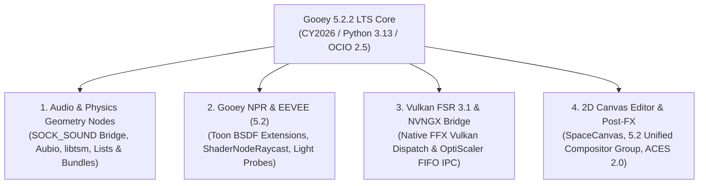
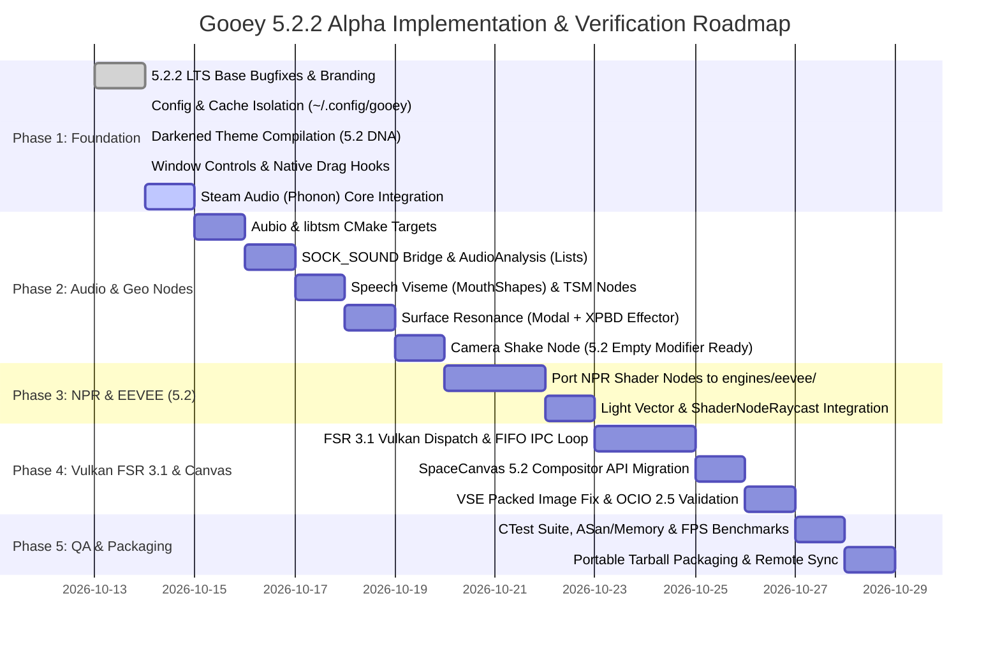

# Gooey 5.2.2 Alpha: Master Porting Report & Architectural Roadmap

**Target Version:** Blender 5.2.2 LTS (`Gooey 5.2.2 Alpha`)  
**Base Repository:** `blender-4.5-port` | **Active Branch:** `gooey-5.2`  
**Reference Source Branch:** `heads/gooey` (4.5 LTS verified implementation)  
**VFX Platform Alignment:** CY2026 (Python 3.13, OCIO 2.5, C++20)  
**Date:** October 14, 2026  

---

## 1. Executive Summary & Current Status

This specification defines the complete architectural roadmap for porting all **Gooey Engine** subsystems from the verified 4.5 LTS codebase into **Blender 5.2.2 LTS**. The core engineering mandate is **Minimal Invasive Rewrites**: instead of fighting upstream Blender 5.x refactors with monolithic C/GLSL hacks, Gooey 5.2 hooks cleanly into Blender 5.2's new data paradigms (`CompositingNodeGroup` ID datablocks, unified `ShaderNode*` compositor evaluations, `SOCK_SOUND` handles, Geometry Node `Lists`/`Bundles`, and the consolidated `engines/eevee/` pipeline) while maintaining 100% configuration isolation from stock Blender installations.

### Completed Milestones in `gooey-5.2`
1. **Upstream 5.2.2 LTS Core & Branding:**
   - Cleanly merged all 82 upstream stability and regression patches from `v5.2.1` through `v5.2.2` (including `dbec94b04d8` image user walk fixes, `23e1dedd88e` OCIO interop IDs, and `161263` empty bundle evaluation guards).
   - Branded release headers in `source/blender/blenkernel/BKE_blender_version.h` as `Gooey 5.2.2 Alpha`.
2. **Configuration, Extension & Cache Isolation:**
   - Redirected user configurations in `BKE_appdir.cc` and `GHOST_SystemPaths` to `~/.config/gooey/5.2/` (Linux/FreeBSD), `%APPDATA%\Gooey\5.2\` (Windows), and `~/Library/Application Support/Gooey/5.2/` (macOS).
   - Isolated shader/BVH/Phonon runtime caches to `~/.cache/gooey/`.
   - Guarantees zero cross-contamination of startup files, extensions, or OCIO profiles with upstream Blender 5.2 LTS.
3. **Hardcoded Darkened DNA Theme (`userdef_default_theme.c`):**
   - Compiled `Darkened.xml` into `release/datafiles/userdef/userdef_default_theme.c`, updated for Blender 5.0+ simplified theme DNA structs and W-axis theme color properties.
4. **Native Window Management & Titlebar Restoration:**
   - Disabled artificial client-side decorations (`WITH_GHOST_CSD=OFF`).
   - Restored integrated topbar window control operators (minimize, maximize/restore toggle, close) and wired native compositor drag hooks (`xdg_toplevel_move` on Wayland, `_NET_WM_MOVERESIZE` on X11).
5. **Steam Audio (Phonon) Core Subsystem:**
   - Integrated `extern/phonon` runtime libraries (`libphonon.so`) and C API headers.
   - Built `bf_intern_audaspace` plugin bridge featuring `PhononReader`, `phonon_device`, `phonon_scene`, `phonon_dsp`, `phonon_simulator`, and `phonon_modal_synth`.
   - Ported evaluated dependency-graph mesh extraction (`BKE_acoustics_scene_sync`), Principled BSDF acoustic absorption/scattering inference (`BKE_acoustics_infer_material`), and rigid-body/XPBD impulse contact processing (`BKE_acoustics_process_rigidbody_contacts`).
   - Exposed opt-in Scene DNA/RNA flags (`flag_audio`, `use_steam_audio`, `steam_audio_all_meshes`, defaulting to `false`) alongside `SCENE_PT_steam_audio` UI and sync operators.

---

## 2. Comprehensive Gap Analysis: Remaining Subsystems

To achieve full feature parity with `heads/gooey` while exploiting Blender 5.2 LTS capabilities, four major subsystems require completion:



---

## 3. Subsystem Breakdown & "Minimal Rewrite" Strategies

### Subsystem 1: Audio & Physics Geometry Nodes

#### Upstream 5.0–5.2 Architectural Context
* **Native Sound Socket (`SOCK_SOUND`):** Blender 5.2 introduced `SOCK_SOUND` (`bNodeSocketType`) and `GeometryNodeSampleSoundFrequencies` (commit `ccedfb3357`), which evaluates cached Audaspace FFT spectrums across frequency bins.
* **Lists & Bundles:** Blender 5.0 introduced `Bundles` (`Get/Set Geometry Bundle`) and 5.2 added native `List` sockets (`Field to List`, `Get List Item`) plus node-based **XPBD Physics Custom Effectors**.
* **VSE Multi-Scene Audio Sync:** Blender 5.0 decoupled the VSE scene from the active viewport scene (`Sync Scene Time`).
* **What Upstream Still Lacks:** Upstream 5.2 has zero support for time-domain fundamental pitch tracking (YIN), transient onset/beat detection, formant-based viseme extraction, WSOLA/phase-vocoder time-scale modification (TSM), or physical BSDF-driven modal resonance synthesis.

#### Minimal Rewrite Porting Strategy
1. **Preserve & Extend `SOCK_SOUND`:** Never delete or shadow upstream's `SOCK_SOUND`. Update Gooey's custom audio nodes to accept **either** an evaluated `Object` (`OB_SPEAKER`) **or** upstream's native `SOCK_SOUND` data-block handle via a unified internal helper (`BKE_gooey_audio_buffer_acquire()`).
2. **Expose 5.2 `List` and `Bundle` Outputs:** Allow `GeometryNodeAudioAnalysis` to optionally emit formant bands as a 5.2 `Float List` and package acoustic state into a `Geometry Bundle` so downstream simulation zones and XPBD custom effectors can consume audio-kinetic forces cleanly.

| Node Name | Node Identifier | Internal Engine | Blender 5.2 Socket & Integration Strategy |
| --- | --- | --- | --- |
| **Speech Viseme Deformer** | `GeometryNodeMouthShapes` | Formant analyzer (`F1`/`F2` LPC) + Preston Blair rig | Accepts Geometry, Time, and `SOCK_SOUND` / `Speaker`. Deforms mouth vertices with smoothstep spherical falloff (`Jaw Open 'A'`, `Lip Wide 'E'`, `Lip Round 'O'`) and outputs raw viseme weights as a `Bundle` for shape-key/bone drivers. |
| **Surface Resonance** | `GeometryNodePropVibration` | `phonon_modal_synth` resonator bank | Queries evaluated object BSDF & mesh bounding thickness; computes fundamental frequency $f_0 = \frac{1}{2L}\sqrt{\frac{E}{\rho}}$ and damping factor $Q$; synthesizes 3D modal vertex offsets and exposes an Effector force output for 5.2 XPBD solvers. |
| **Camera Shake** | `GeometryNodeCameraShake` | Mo-cap shaker + Aubio impulse envelope | 9 motion-capture profiles with frequency/amplitude modulation and transient onset recoil triggers. Compatible with 5.2's Empty-object Geometry Nodes modifiers for direct camera parent rigs. |
| **Audio Analysis** | `GeometryNodeAudioAnalysis` | `extern/aubio` | Dual-mode input (`SOCK_SOUND` or `Speaker`). Outputs scalar `Pitch (Hz)`, `MIDI Note`, `Onset Impulse`, `Beat Phase`, `BPM`, `Viseme ID`, plus a 5.2 `Float List` of formant band energies. |
| **Audio Time Stretch** | `GeometryNodeAudioTSM` | `extern/libtsm` | WSOLA & phase-vocoder time-scale modification. Evaluates non-destructive `Stretched Time`, `Speed Factor`, and `Pitch Shift Factor` (`2^(semitones/12)`) before feeding downstream audio or animation nodes. |

---

### Subsystem 2: Gooey NPR Shading & EEVEE Integration

#### Upstream 5.0–5.2 Architectural Context
* **Directory & Engine Consolidation:** The `eevee_next` transition directory was consolidated back into **`source/blender/draw/engines/eevee/`** (and RNA engine ID `BLENDER_EEVEE`). Any patch paths targeting `engines/eevee_next/` from 4.2/4.3 branches must be remapped to `engines/eevee/`.
* **New 5.1/5.2 NPR Primitives:**
  - Blender 5.1 added **`ShaderNodeRaycast`** (enabling shader-level local ambient occlusion, bevel/rim detection, and projected toon decals) and **25–50% faster EEVEE shader source preprocessing**.
  - Blender 5.2 removed the 8-attribute-per-material limit, added **dithering to eliminate gradient banding**, and enabled **`Shader to RGB` inside Plane Light Probes** and blended materials.
  - Blender 5.0 removed `material.use_nodes` and `world.use_nodes` (materials always evaluate node trees; reading `use_nodes` returns `True` as a deprecated stub).

#### Minimal Rewrite Porting Strategy
Avoid modifying EEVEE's core deferred/forward GBuffer packing in `eevee_pipeline.cc` where possible; implement Gooey NPR features as **modular GPU shader nodes (`source/blender/nodes/shader/nodes/`) and GLSL library functions (`source/blender/gpu/shaders/material/`)**:
1. **Anti-Aliased Cel / Toon Ramp Evaluation:** Port Gooey's derivative-aware (`fwidth`) stepped ramp and Cel BSDF evaluation as node-level GLSL functions that consume output from `ShaderNodeShaderToRGB` or custom light-loop closures.
2. **Light Vector & Rim/Shadow Extraction Node:** Expose active key-light direction, shadow-map attenuation, and half-angle specular quantization to the Shader Node tree, complementing 5.1's `ShaderNodeRaycast` for cavity/ink-line masking.
3. **Light & Shadow Linking Compliance:** Respect Blender 5.2's overrideable light/shadow linking bitmasks (`eevee_light_linking`) so character rim lights and face shadow terminators isolate cleanly per collection.

---

### Subsystem 3: Vulkan FSR 3.1 & NVNGX Bridge

#### Architectural Context
* Branch `feature/fsr4-eevee-bridge` establishes the vendor-agnostic `intern/nvngx_bridge/` abstraction layer.
* `source/blender/draw/engines/eevee/eevee_upscale.cc` intercepts viewport jitter matrices, velocity/motion vector passes (`eevee_velocity`), depth buffers, and color targets prior to final viewport presentation.

#### Minimal Rewrite Porting Strategy
1. **Native Vulkan FSR 3.1 Context Dispatch:**
   - Complete `nvngx_bridge_api.cc::evaluate_fsr31_vulkan()` by binding Blender's `GHOST_ContextVK` / `GPUContext` `VkCommandBuffer`, `VkImage`, and `VkImageView` handles into `FfxFsr3UpscalerDispatchDescription` and invoking `ffxFsr3UpscalerContextDispatch()`.
   - Ensure sub-pixel Halton camera jitter offsets in `eevee_cameras.cc` match the active FSR scale ratio (`1.5x` Quality, `1.7x` Balanced, `2.0x` Performance) and reset temporal accumulation on viewport navigation cuts.
2. **Proton / OptiScaler POSIX IPC Worker:**
   - Finalize the non-blocking POSIX named-pipe (`mkfifo`) and shared DMA-BUF / opaque FD descriptor loop in `blender_upscaler_worker.cc` for external OptiScaler / FSR4 injection when running under Linux Wayland/X11.
3. **Strict Opt-In Guardrails:**
   - Keep `SceneEEVEE.use_upscale` defaulting to `false`. Automatically bypass upscale dispatch and fall back to native TAA when rendering under the OpenGL backend or when viewport resolution is below `128x128`.

---

### Subsystem 4: 2D Canvas Editor, VSE Sync & Color Management (OCIO 2.5)

#### Upstream 5.0–5.2 Architectural Context (Breaking Changes)
* **Compositor Overhaul (Blender 5.0–5.2):**
  - `scene.use_nodes` and `scene.node_tree` are **deprecated/removed**. Compositor setups now live in standalone `CompositorNodeTree` ID datablocks assigned to **`scene.compositing_node_group`**.
  - `CompositorNodeComposite` is **removed**; trees must terminate in **`NodeGroupOutput`** with a `Color` socket as the first input.
  - Legacy compositor nodes (`CompositorNodeMixRGB`, `CompositorNodeRGB`, `CompositorNodeMath`, `CompositorNodeValToRGB`) were **removed and unified** with `ShaderNodeMix`, `ShaderNodeRGB`, `ShaderNodeMath`, and `ShaderNodeValToRGB`.
  - Node enum properties (e.g., blend mode, clamp) are now **input sockets** (`node.inputs["Blend Type"].default_value`) rather than RNA attributes.
  - Blender 5.2 added **`CompositorNodeBlankImage`** for hardware-accelerated base canvas generation.
* **Color Management (OCIO 2.5 & ACES 2.0):**
  - Blender 5.0/5.1 migrated to **OCIO 2.5**, scene-linear brush/palette storage, HDR wide-gamut viewports, and **ACES 2.0** support, plus `.blend` OCIO config mismatch checks and 5.2.2 display interop IDs.

#### Minimal Rewrite Porting Strategy
1. **Refactor `space_canvas.py` Compositor Tree Compiler for 5.2 API:**
   - Replace `scene.node_tree` with `scene.compositing_node_group` (initializing via `bpy.data.node_groups.new("GooeyCanvasComp", "CompositorNodeTree")`).
   - Replace `CompositorNodeRGB` base artboard initialization with 5.2's native **`CompositorNodeBlankImage`** (passing artboard `Width`, `Height`, and background `Color` inputs directly).
   - Replace `CompositorNodeMixRGB` with **`ShaderNodeMix`** (`node.data_type = 'RGBA'`, setting blend modes via `node.inputs['Blend Type'].default_value` and opacity via `node.inputs['Factor']`).
   - Terminate the layer stack into **`NodeGroupOutput`** (`tree.interface.new_socket(name="Image", in_out='OUTPUT', socket_type='NodeSocketColor')`).
2. **Fix `sync_canvas_sequencer()` & Packed Data-blocks:**
   - For raster layer strips where `image.packed_file` is active and `bpy.path.abspath(image.filepath)` does not exist on disk, flush the packed buffer to `os.path.join(bpy.app.tempdir, f"gooey_layer_{image.name}.png")` prior to calling `scene.sequence_editor.strips.new_image()`.
   - Additionally support 5.2's native **VSE Strip Compositor Modifier**, allowing the live `GooeyCanvasComp` node group to evaluate non-destructively inside the VSE timeline without disk I/O bottlenecks.
3. **Wire `CANVAS_HT_footer` Cursor Readouts:**
   - Expose View2D artboard-space mouse coordinates $(X, Y)$, zoom percentage, and active layer bit-depth in `source/blender/editors/space_canvas/space_canvas.cc` via RNA so `CANVAS_HT_footer` updates smoothly on mouse move.
4. **Upgrade Color Management Config to OCIO 2.5 / ACES 2.0 + 1.3 Compatibility:**
   - Update `release/datafiles/colormanagement/config.ocio` to syntax `ocio_profile_version: 2.5`, retaining Gooey's ACES 1.3 views alongside Blender 5.2's expected `display_color_interop_id` tags and scene-linear brush roles so zero OCIO warnings trigger on startup.

---

## 4. Step-by-Step Implementation Roadmap



---

## 5. Technical Rules & Hardware Build Constraints

1. **System Memory & Linker Concurrency Guardrails (12 GiB RAM / 16 Threads):**
   - Heavy C++20 template instantiation in `bf_nodes`, `bf_blenkernel`, and `bf_draw` will trigger Linux OOM-killer aborts if compiled or linked with unbounded concurrency.
   - **Configure CMake with `mold` (or `lld`), `ccache`, and serialized link pools:**
     ```bash
     cmake -B ../build_linux_5.2 -G Ninja \
       -DCMAKE_BUILD_TYPE=Release \
       -DCMAKE_C_COMPILER_LAUNCHER=ccache \
       -DCMAKE_CXX_COMPILER_LAUNCHER=ccache \
       -DCMAKE_EXE_LINKER_FLAGS="-fuse-ld=mold" \
       -DCMAKE_SHARED_LINKER_FLAGS="-fuse-ld=mold" \
       -DCMAKE_JOB_POOL_COMPILE="compile_pool=4" \
       -DCMAKE_JOB_POOL_LINK="link_pool=1" \
       -DCMAKE_JOB_POOLS="compile_pool=4;link_pool=1" \
       -DWITH_GHOST_CSD=OFF
     ```
   - **Always execute Ninja under idle I/O and CPU scheduling:**
     ```bash
     nice -n 19 ionice -c 3 ninja -C ../build_linux_5.2 -j4 install
     ```

2. **Strict Path Hygiene:**
   - Zero hardcoded `/home/...` user paths in C/C++, CMakeLists, or Python scripts.
   - Use `${CMAKE_SOURCE_DIR}` / `${LIBDIR}` at build time and `BKE_appdir_folder_id(BLENDER_USER_CONFIG, ...)` / `bpy.app.tempdir` at runtime.

3. **Opt-In Performance Philosophy:**
   - Expensive background solvers (Steam Audio raytracing, modal synthesis banks, FSR 3.1 swapchain workers) must remain strictly opt-in (`Scene.use_steam_audio = False`, `Scene.eevee.use_upscale = False` by default) so base startup time and viewport playback remain identical to or faster than stock Blender 5.2.2 LTS.

4. **Python 3.13 & 5.2 RNA Strictness:**
   - All startup UI scripts (`space_canvas.py`, `properties_scene.py`) must adhere to Blender 5.2's Python 3.13 runtime, avoiding deprecated `scene.use_nodes`, `scene.node_tree`, and `CompositorNodeMixRGB` calls.
