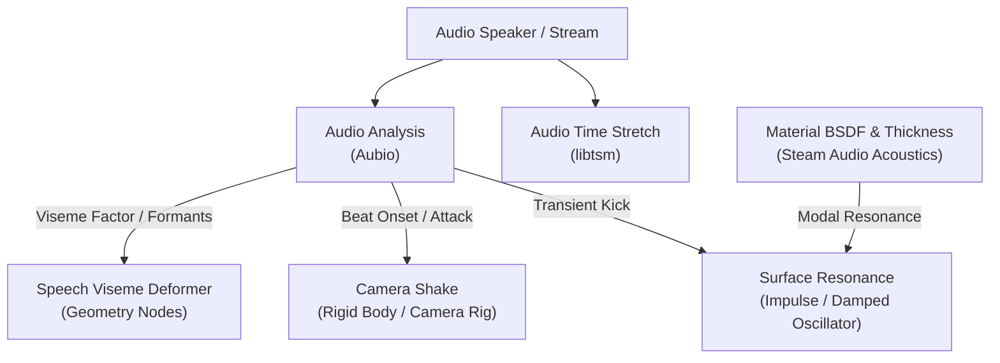

# Geometry Nodes Audio, Physics & Animation System Guide

This guide covers socket definitions, workflows, and architecture for procedural audio analysis, lipsync deformation, physical surface resonance, and motion capture camera shake in Blender.

---

## 1. Node Reference & Sockets

### 1. `Speech Viseme Deformer` (`GeometryNodeMouthShapes`)
- **Category**: `Geometry/Operations`
- **Purpose**: Deform character mouth and facial geometry driven by acoustic speech formant analysis (Open 'A', Wide 'E', Round 'O') with smoothstep spherical falloff.
- **Input Sockets**:
  - `Geometry`: Mesh geometry of the character head/face.
  - `Time`: Evaluation time in seconds (`-1` automatically tracks scene time).
  - `Speaker`: Target speaker object containing dialogue or vocals.
  - `Mouth Center`: 3D coordinate vector for center of the lips/mouth.
  - `Influence Radius`: Spherical radius in meters for deformation falloff.
  - `Jaw Open Scale`: Vertical jaw drop amplitude in meters (open vowel 'A').
  - `Lip Wide Scale`: Horizontal smile spread amplitude in meters (wide vowel 'E').
  - `Lip Round Scale`: Forward protrusion amplitude in meters (round vowel 'O').
  - `Sensitivity`: Multiplier for acoustic energy response.
  - `Smoothing`: Temporal EMA smoothing factor `[0.0 to 1.0]`.
- **Output Sockets**:
  - `Geometry`: Deformed character mesh.
  - `Jaw Open`: Normalized float factor `[0.0 to 1.0]`.
  - `Lip Wide`: Normalized float factor `[0.0 to 1.0]`.
  - `Lip Round`: Normalized float factor `[0.0 to 1.0]`.
  - `Viseme Vector`: 3D combined weight vector `(X=Open, Y=Wide, Z=Round)`.

---

### 2. `Surface Resonance` (`GeometryNodePropVibration`)
- **Category**: `Geometry/Operations`
- **Purpose**: Synthesizes physical damped modal vibrations driven by material BSDF, geometry thickness, and impact energy impulses or audio transients.
- **Input Sockets**:
  - `Geometry`: Mesh geometry of the prop or colliding body.
  - `Time`: Playback time in seconds (`-1` for current scene time).
  - `Object`: Reference object to query material BSDF and thickness (`None` samples self).
  - `Trigger / Impulse`: Kinetic impact energy in Joules or transient attack factor.
  - `Frequency`: Resonant fundamental frequency $f_0$ in Hz (`-1` auto-calculates from mesh thickness and material speed of sound).
  - `Damping`: Modal damping decay rate $\zeta$ (`-1` auto-calculates from material absorption).
  - `Amplitude Scale`: Visual displacement multiplier in meters.
  - `Vibration Axis`: 3D direction vector of oscillation.
- **Output Sockets**:
  - `Geometry`: Vibrating geometry.
  - `Offset`: Instantaneous 3D resonance vector offset (plugs directly into *Set Position* `Offset`).
  - `Displacement`: Vector displacement offset (for backwards compatibility).
  - `Amplitude`: Current instantaneous decay envelope amplitude.
  - `Resonant Freq (f0)`: Fundamental frequency in Hz.
  - `Damping (Q)`: Effective acoustic Q-factor.

---

### 3. `Camera Shake` (`GeometryNodeCameraShake`)
- **Category**: `Geometry/Operations`
- **Purpose**: Applies authentic motion-captured camera shake profiles directly to mesh controller rigs bound to cameras via `Camera Shakify` constraints.
- **Input Sockets**:
  - `Geometry`: Rig mesh geometry.
  - `Time`: Evaluation time in seconds.
  - `Camera`: Target camera reference.
  - `Location`: Base camera position offset vector.
  - `Rotation`: Base camera Euler rotation vector.
  - `Profile`: Integer preset index `[0 - 8]` (Investigation, Closeup, Wedding, Walk, Run, Car, Bike, Spaceship, Zeek).
  - `Frequency`: Playback speed and oscillation rate.
  - `Intensity`: Wobble amplitude multiplier.
  - `Audio Trigger`: Aubio onset impulse for kick/recoil modulation.
  - `Seed`: Random variation seed.
- **Output Sockets**:
  - `Geometry`: Transformed shaker mesh.
  - `Offset Location`: Shake translation offset vector.
  - `Offset Rotation`: Shake rotational wobble Euler angles.
  - `Transform Matrix`: 4x4 wobble transformation matrix.
  - `Final Location`: Base camera location plus shake offset.
  - `Final Rotation`: Base camera rotation plus shake rotation.

---

### 4. `Audio Analysis` (`GeometryNodeAudioAnalysis`)
- **Category**: `Input/Scene`
- **Features**: Aubio real-time pitch detection (YIN), spectral onset detection, tempo/beat tracking.
- **Outputs**: `Volume`, `Onset`, `Pitch`, `Is Beat`, `Beat Phase`, `BPM`, `Viseme`.

---

### 5. `Audio Time Stretch (TSM)` (`GeometryNodeAudioTSM`)
- **Category**: `Input/Scene`
- **Features**: libtsm time-scale modification (WSOLA & phase vocoder) for artifact-free pitch and speed manipulation.
- **Outputs**: `Stretched Time`, `Speed Factor`, `Pitch Shift Factor`, `Time Delta`.

---

## 2. Spatial Acoustics & Phonon Pipeline

1. **Scene Transition**:
   - Run `bpy.ops.scene.steam_audio_transition_scene()` or trigger from the Audio properties panel to tag all scene meshes and build ray-traced acoustic geometry.
2. **BSDF Physical Mapping**:
   - `Metallic`: Low acoustic scattering, high specular sound bounce.
   - `Roughness`: High diffusion and acoustic scattering.
   - `Transmission`: Sound transmission through thin surfaces (glass/water).
   - `IOR`: Acoustic velocity impedance.
