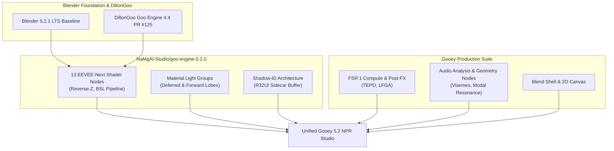

# Gooey 5.2 & Goo Engine 5.2 Collaboration Roadmap

This roadmap outlines the plan for migrating the Gooey NPR studio tools onto the **Blender 5.2.1 LTS** and **Goo Engine 5.2** architecture maintained by **NaMgAl-Studio** (`NaMgAl-Studio/goo-engine-5.2.0`).

---

## 1. Vision & Strategy



### Strategic Objectives:
1. **Target Popular Upstream Repo (`NaMgAl-Studio/goo-engine-5.2.0`)**:
   - Rather than maintaining fragmented forks, submit modular PRs directly to `NaMgAl-Studio/goo-engine-5.2.0` so the community benefits in one central place.
2. **Phase Out 4.5**:
   - Stop backporting to 4.5. Focus 100% of engineering bandwidth on Blender 5.2+ and EEVEE-Next.
3. **Decouple and Modularize**:
   - Keep C++ additions self-contained (avoid monolithic edits to `makesdna` or core `depsgraph` loops).
   - Ensure optional features can be toggled via CMake flags (`-DWITH_GOOEY_STEAM_AUDIO=OFF`).

---

## 2. Technical Phasing

| Phase | Component | Description | Status |
| :--- | :--- | :--- | :--- |
| **Phase 1** | **Repository Unification & Documentation** | Document build setup, precompiled downloads, and collaboration workflows for NaMgAl 5.2. | ✅ Completed |
| **Phase 2** | **NPR Upscaling & Post-Processing Nodes** | Port `CMP_NODE_FSR1` (EASU/RCAS with NPR edge mask), `CMP_NODE_TEPD` (blue-noise dither), and `CMP_NODE_LFGA` (film grain) into the 5.2 compositor. | 🔨 Staged on branch |
| **Phase 3** | **Blend Shell & Canvas 2D Pipeline** | Integrate Python console CLI tools (`blend_shell.py`) and 2D NPR Canvas setup into 5.2. | 🔨 Staged on branch |
| **Phase 4** | **Audio & Geometry Nodes Modernization** | Implement audio analysis and procedural viseme/resonance nodes with background caching to prevent frame-scrub lag. | 📋 Planned |
| **Phase 5** | **Upstream PR Submission** | Prepare clean, atomic PRs against `NaMgAl-Studio/goo-engine-5.2.0` organized by subsystem. | 📋 Planned |

---

## 3. Contributing & Pushing Changes

To contribute to NaMgAl Studio or push to your personal fork:
```bash
# Push working branch to personal fork
git push gooey gooey-5.2

# When ready to open PR to NaMgAl:
# 1. Fetch latest upstream
git fetch namgal main

# 2. Rebase or cherry-pick cleanly onto namgal/main
git rebase namgal/main

# 3. Create topic branch and push
git checkout -b feature/npr-postfx-nodes
git push gooey feature/npr-postfx-nodes
# 4. Open Pull Request on https://github.com/NaMgAl-Studio/goo-engine-5.2.0/pulls
```
